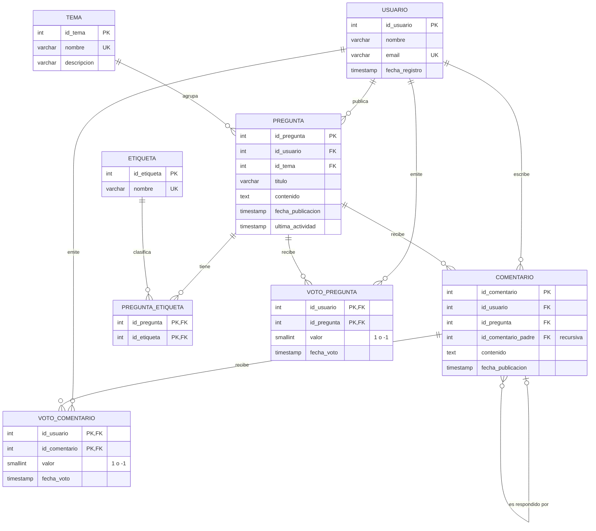

# Diagrama E-R final — Foro de Ayuda Técnica

El modelo tal como quedó implementado en `db/01_ddl_completo.sql`.
GitHub dibuja este diagrama automáticamente. En VS Code se ve con la extensión *Markdown Preview Mermaid Support*.

## Relaciones y qué pasa al borrar

| Relación | Cardinalidad | Al borrar el "padre" |
|---|---|---|
| usuario → pregunta | 1 : N | **Se impide** (409: "el usuario tiene preguntas publicadas") |
| usuario → comentario | 1 : N | **Se impide** (409: "el usuario tiene comentarios publicados") |
| tema → pregunta | 1 : N | **Se impide** (409: "el tema tiene preguntas") |
| pregunta → comentario | 1 : N | Se borran sus comentarios (CASCADE) |
| comentario → comentario (respuesta) | 1 : N, recursiva | Se borran sus respuestas (CASCADE) |
| pregunta ↔ etiqueta | N : M (tabla `pregunta_etiqueta`) | Se borra la asociación (CASCADE) |
| usuario/pregunta → voto_pregunta | N : M con atributo `valor` | Se borran los votos (CASCADE) |
| usuario/comentario → voto_comentario | N : M con atributo `valor` | Se borran los votos (CASCADE) |

## Cambio respecto a la Entrega 3

Se agregó `pregunta.ultima_actividad`. Guarda cuándo tuvo actividad la pregunta por última vez, y la actualiza el trigger `trg_comentario_actualiza_pregunta`.
